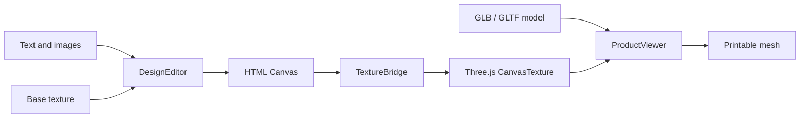

<div align="center">


<h1>CustomForge</h1>

<p>A TypeScript library for editing text and images on a 2D canvas and previewing them on a 3D product</p>

<p><strong>Website:</strong> <a href="https://customforge.org">https://customforge.org</a></p>

<p>
  <strong>English</strong>
  <span> · </span>
  <a href="./README.zh-CN.md">简体中文</a>
</p>

<p>
  <a href="https://www.npmjs.com/package/customforge"></a>
  <a href="./LICENSE"></a>
</p>

</div>

## Demo


## Quick Start

Install the package in your frontend project:

```bash
npm install customforge
```

With pnpm, use `pnpm add customforge`. Fabric.js and Three.js are included as dependencies

Add a container with an explicit height:

```html
<div id="customforge-workbench" style="height: 640px"></div>
```

Then initialize the Workbench from your application's client entry, after the container is mounted:

```ts
import { createWorkbench } from 'customforge/workbench'
import 'customforge/style.css'

const workbench = await createWorkbench({
  container: '#customforge-workbench',
})
```

This loads the bundled cup model and the default editing interface. Add text or upload an image in the left panel; the design appears on the cup as you edit. No model files are needed for this example

Call `workbench.destroy()` when the editor is no longer needed. In React, Vue, or another component framework, initialize it on the client and destroy it during component cleanup

If your application supplies its own controls, use `createCustomizer()` from `customforge`; see [Build Your Own UI](#build-your-own-ui)

## Documentation

- [Quick start](https://customforge.org/guide/quick-start.html)
- [Configure the Workbench](https://customforge.org/guide/workbench.html)
- [Build your own UI with the core API](https://customforge.org/guide/core-library.html)
- [Prepare a product model](https://customforge.org/guide/product-assets.html)

## Features

CustomForge uses Fabric.js for 2D editing and Three.js for the product preview. It works with plain TypeScript or a frontend framework

- Edit text content, font, size, color, alignment, and spacing
- Upload, move, resize, and rotate images, or fit an image to the printable area as a background
- Upload a GLB or load a remote GLB/GLTF, choose the printable mesh, and rotate or zoom the preview
- Use the model's UV boundary as an editing guide and export the design as a PNG without the guide or selection controls
- Manage layers, undo and redo changes, and save or restore editable designs as Design JSON
- Customize the Workbench's branding, labels, theme, icons, and asset presets; add application buttons or build a separate UI through the core API

## Browser and Installation Notes

Browser baseline: Chrome and Edge 111+, Firefox 113+, and Safari 16.4+. CustomForge requires ES2022 modules, Canvas 2D, WebGL, `ResizeObserver`, native `dialog`, container queries, and `color-mix()` support

pnpm may report that the optional native `canvas` build script was ignored. CustomForge runs in the browser and does not use Node native canvas, so `pnpm approve-builds` is not required for this package

Projects can record this choice in `package.json`:

```json
{
  "pnpm": {
    "ignoredBuiltDependencies": ["canvas"]
  }
}
```

## Load Your Product

Choose **Load product** in the demo, then upload a self-contained `.glb` file or
provide a remote GLB / GLTF URL. Local `.gltf` files are not accepted because
they can depend on separate binary and texture files

The following fields are available under **Advanced options**:

| Setting | Purpose |
| --- | --- |
| Base artwork URL | Optional image placed underneath editable objects and included in the composed texture |
| Printable mesh name | Name of the mesh that receives the live canvas texture; defaults to `PrintArea` |
| Flip texture vertically | Enable only when the design appears vertically inverted on a model |

UV coordinates are expected to be stored in the 3D model

The optional texture image is the visual base layer, not a replacement for model UV data. Without one, the design canvas and printable overlay remain transparent

After each product load, the editor reads the target mesh UV coordinates and displays a subtle printable-region fill with its outer boundary above the design canvas. Internal triangulation stays hidden, and the guide is not written into the live texture, Design JSON, or exported PNG

High-density printable meshes are supported without synchronously closing every UV triangle path or reading canvas pixels during production rendering. Model download, geometry extraction, GPU work, and memory usage still scale with mesh complexity, so production assets should retain only the detail required by the product and printable surface

> [!IMPORTANT]
> Remote models, textures, decals, and fonts must be served with CORS headers that allow the app origin
>
> A blocked or canvas-tainting resource may fail to load and can prevent PNG export

## Build Your Own UI

`createCustomizer()` provides the editor and viewer without the Workbench controls. Mount them in two separate DOM containers and connect your own UI to the returned `ProductCustomizerApi`:

CustomForge is browser-only and must be initialized after its DOM containers are available

The editor and viewer require two different containers; call `destroy()` when the page, host component, or instance is no longer in use to release Fabric, WebGL, observer, and event resources

```html
<div id="texture-editor"></div>
<div id="product-viewer"></div>
```

```ts
import { createCustomizer } from 'customforge'
import 'customforge/style.css'

const customizer = await createCustomizer({
  editor: '#texture-editor',
  viewer: '#product-viewer',
  editorWidth: 1024,
  editorHeight: 512,
  product: {
    modelUrl: 'https://example.com/product.glb',
    textureUrl: 'https://example.com/base-texture.png',
    surfaceMesh: 'PrintArea',
    textureFlipY: false,
  },
  appearance: {
    editor: {
      controlSize: 7,
      objectBorder: '#0057b8',
      uvBoundary: '#d92d20',
    },
    viewer: { backgroundColor: '#f4f4f5' },
  },
})

customizer.addText({
  text: 'Hello world',
  x: 120,
  y: 180,
  fontSize: 64,
  fontWeight: 'bold',
  textAlign: 'center',
  color: '#172126',
})

await customizer.addImage({
  src: 'https://example.com/logo.png',
  x: 720,
  y: 240,
  width: 220,
})

window.addEventListener('beforeunload', () => customizer.destroy(), {
  once: true,
})
```

The public package uses the same root and style imports as the local `.tgz`; pin an exact version when reproducible installs are required

## Configure the Workbench

Pass options to `createWorkbench()` to load your product, set branding and labels, or adjust the interface

The host element must have an explicit height so the design surface, collapsible layers panel, and 3D preview can measure their available space

```html
<div id="customforge-workbench" style="height: 720px"></div>
```

```ts
import { createWorkbench } from 'customforge/workbench'
import 'customforge/style.css'

const workbench = await createWorkbench({
  container: '#customforge-workbench',
  className: 'store-customizer',
  product: {
    modelUrl: 'https://example.com/product.glb',
    surfaceMesh: 'PrintArea',
  },
  features: {
    presetBackgrounds: true,
    presetElements: true,
  },
  layout: {
    header: true,
    layers: true,
  },
  branding: {
    logoUrl: '/brand/logo.png',
    title: 'Studio',
    subtitle: 'Product personalization',
  },
  labels: {
    addText: 'Typography',
    addImage: 'Artwork',
    productDialogTitle: 'Choose a product model',
    loadingProduct: 'Loading product...',
  },
  fontFamilies: [
    { value: 'Arial', label: 'Arial' },
    { value: 'Georgia', label: 'Georgia' },
  ],
  formatError: (error) =>
    error instanceof Error ? error.message : 'The operation failed',
  theme: {
    accent: '#0057b8',
    accentHover: '#003f87',
    accentContrast: '#ffffff',
  },
  assets: {
    backgrounds: [
      { id: 'floral', name: 'Floral', url: '/presets/floral.png' },
    ],
    elements: [
      { id: 'flower', name: 'Flower', url: '/presets/flower.png' },
    ],
  },
})
```

The bundled CustomForge logo is used by default and can be replaced or hidden through `branding`

`labels` covers every fixed Workbench label, Dialog message, placeholder, validation prompt, status, color name, download filename, and accessibility name. `fontFamilies`, `textPresets`, `assets`, and `branding` control the visible names generated from configurable data, while `formatError` converts model, image, UV, and Design JSON failures into user-facing copy

CustomForge provides default English copy but does not own application locale state. Build the options from the host application's i18n system and create the Workbench with the active language pack. This keeps locale routing and fallback behavior in the consuming application instead of coupling the library to a specific i18n framework

Use the exported `WorkbenchLabels` type when authoring a complete language pack; `WorkbenchOptions.labels` remains partial so applications only overriding a few terms are not forced to repeat the defaults

`theme` maps to scoped CSS variables, and `icons` can disable built-in icons or replace individual semantic icons with image URLs

`appearance` configures Fabric selection controls, UV helper colors, and the WebGL clear color that normal Workbench CSS cannot style reliably

The default UI font stack prefers the rounded `Nunito Sans` family and falls back to system sans-serif fonts

CustomForge bundles the font asset and does not fetch third-party font services at runtime

Text and image commands open focused Dialogs instead of immediately mutating the canvas

- The text Dialog includes an input, color control, and replaceable typography presets
- Selecting one or more text objects reveals contextual controls inside the existing single-row toolbar for font family, size, bold, italic, underline, alignment, text color, highlight, line height, and letter spacing without shifting the canvas
- The contextual toolbar supports mixed multi-selection values and an explicit command for entering on-canvas text editing
- The image Dialog includes local upload, background presets, and decorative element presets
- A design background replaces the previous design background, fills the current product's UV printable bounds, starts locked at the bottom layer, and persists in Design JSON
- Selecting an ordinary image reveals a command that converts it into the design background, fits it to the current UV printable bounds, and moves it to the bottom layer

Feature and layout switches can also be changed after initialization

```ts
workbench.setFeature('addText', true)
workbench.setLayout('header', true)
workbench.setTheme({ accent: '#0057b8' })
```

### Extend the Workbench with application actions

Register application-owned buttons through `extensions` instead of querying or rewriting Workbench DOM. Each action receives the public Workbench and headless customizer APIs, a current state snapshot, the current selection, and the target layer when applicable:

```ts
const workbench = await createWorkbench({
  container: '#customforge-workbench',
  className: 'store-customizer',
  extensions: [
    {
      id: 'store.export-png',
      placement: 'globalActions',
      label: t('actions.exportPng'),
      variant: 'primary',
      className: 'store-export-command',
      onClick: async ({ customizer, workbench, signal }) => {
        const blob = await customizer.getTextureBlob()
        if (!signal.aborted) {
          workbench.setStatus(`${blob.size} bytes`)
        }
      },
    },
    {
      id: 'store.straighten',
      placement: 'selectionToolbar',
      label: t('actions.straighten'),
      visible: ({ selection }) => selection.length === 1,
      disabled: ({ selection }) => selection.some(({ locked }) => locked),
      onClick: ({ customizer, selection }) => {
        selection.forEach(({ id }) => {
          customizer.updateObjectTransform(id, { rotation: 0 })
        })
      },
    },
  ],
})
```

| Placement | Intended use | Additional context |
| --- | --- | --- |
| `globalActions` | Product-, export-, or workflow-level commands | Standard state and selection |
| `editorToolbar` | Design commands that do not require a selection | Standard state and selection |
| `selectionToolbar` | Commands for the active selection | Hidden automatically without a selection |
| `layerActions` | Compact commands repeated for each layer | `layer` contains that row's object |

`visible` and `disabled` accept booleans or state predicates. Predicates refresh automatically after CustomForge state, selection, history, and view events; call `workbench.refreshExtensions()` when they also depend on host application state. Promise-returning actions enter a disabled loading state and rejected actions are passed through `formatError` to the existing status region.

Use `iconUrl`, `showLabel`, `variant`, `order`, and `className` to control presentation. Extension labels are application data, so pass the active i18n string. Scope deeper CSS with the Workbench `className` and the extension's own `className`:

```css
.store-customizer .store-export-command {
  text-transform: uppercase;
}
```

Extensions can also be managed after initialization. The cleanup function only removes the registration that created it:

```ts
const unregister = workbench.registerExtension(action)
const actions = workbench.getExtensions()
workbench.removeExtension('store.export-png')
unregister()
```

`workbench.getFeatures()`, `workbench.getLayout()`, `workbench.getTheme()`, and `workbench.getExtensions()` return independent snapshots. `className` is applied only to that Workbench root, so application CSS can target one instance without relying on a global selector. For a fully custom interface, use `createCustomizer()` instead of restyling or querying Workbench internals.

| Feature switch | Controls |
| --- | --- |
| `addText`, `addImage`, `deleteSelection` | Object Dialogs and deletion |
| `textFormatting` | Contextual text formatting toolbar |
| `undoRedo` | Undo and redo buttons plus Workbench keyboard shortcuts |
| `saveDesign`, `loadDesign` | Design JSON actions |
| `loadRemoteProduct`, `resetView` | Product loading and preview actions |
| `reorderObjects`, `toggleObjectVisibility`, `lockObjects`, `renameObjects` | Layer management |
| `presetBackgrounds`, `presetElements` | Image Dialog preset tabs |

| Layout switch | Region |
| --- | --- |
| `header` | Brand and global product actions |
| `editorHeader`, `viewerHeader` | Workspace panel headings |
| `toolbar` | Design tool controls |
| `layers` | Collapsible object layer panel and toolbar entry |
| `status` | Runtime status inside the 3D preview |

All feature and layout values default to `true`

Feature switches only control the built-in Workbench controls and do not remove methods from `workbench.customizer`

Theme values are intended for coherent product-level styling rather than per-button color configuration

```ts
const workbench = await createWorkbench({
  container: '#customforge-workbench',
  icons: {
    enabled: true,
    sources: {
      addText: '/icons/typography.svg',
      loadProduct: '/icons/upload.svg',
    },
  },
  textPresets: [
    {
      id: 'brand-display',
      name: 'Brand display',
      fontFamily: 'Arial',
      fontSize: 72,
      width: 460,
      color: '#17191c',
    },
  ],
})
```

## Design JSON

`saveDesign()` returns a Library-owned, JSON-safe document instead of exposing Fabric.js serialization. `loadDesign()` validates unknown input and restores the editable object stack asynchronously:

```ts
const design = customizer.saveDesign()
localStorage.setItem('customforge-design', JSON.stringify(design))

const savedDesign = localStorage.getItem('customforge-design')
if (savedDesign) {
  await customizer.loadDesign(JSON.parse(savedDesign))
}
```

The current Schema version is `1`. It stores the logical canvas size and the text and image objects in back-to-front render order, including stable object IDs, names, visibility, locking, image roles, center-based transforms, and rich text formatting. Existing version 1 documents without the optional formatting fields continue to load with the original bold, centered defaults

Design JSON intentionally excludes the product model, target mesh, and base texture. A document can only be loaded into an editor with exactly the same logical width and height

An image with `role: 'background'` is a design object rather than the product base texture. Only one is allowed, it must be the first object, and older version 1 documents without `role` continue to load as ordinary image elements

Loading is transactional: the current design remains unchanged unless the document validates and every referenced image loads successfully. Blob URL images are converted to Data URLs when added; remote image URLs remain URLs and must continue to satisfy browser CORS requirements when restored

Design JSON version 1 remains readable throughout the `0.1.x` release line. New optional fields may be added without invalidating existing version 1 documents

## Undo and Redo

History is enabled in both the headless core and Workbench and defaults to 50 undo steps

Set `historyLimit` in `createCustomizer` or `createWorkbench` options to change the retained undo depth

```ts
if (customizer.canUndo()) {
  await customizer.undo()
}

await customizer.redo()
customizer.clearHistory()

const stop = customizer.on('historychange', ({ canUndo, canRedo }) => {
  console.log({ canUndo, canRedo })
})
```

History covers object creation, deletion, canvas transforms, text content and formatting edits, image-to-background conversion, layer order, names, visibility, locking, and Design JSON loading

Workbench also supports `Ctrl` or `Cmd` + `Z`, `Ctrl` or `Cmd` + `Shift` + `Z`, and `Ctrl` + `Y` while focus is outside form fields

Successful product replacement keeps the current design but starts a new history baseline

## Instance API

| Method | Description |
| --- | --- |
| `addText(options)` | Add and select editable text, constrained to the canvas; `fontSize` defaults to `22` |
| `addImage(options)` | Load and select an element or replace the design background |
| `getState()` | Return product, canvas, printable bounds, objects, selection, history, and 3D view in one snapshot |
| `getProduct()` | Return the resolved current product configuration |
| `getCanvasSize()` | Return the logical texture dimensions |
| `getPrintableBounds()` | Return the UV printable bounds in logical canvas coordinates |
| `getObjects()` | Return the current objects in back-to-front layer order |
| `getSelectedObjectIds()` | Return stable IDs for the current selection |
| `selectObject(id)` | Select a visible object by stable ID |
| `selectObjects(ids)` | Select multiple visible objects by stable ID |
| `clearSelection()` | Clear the current canvas selection without changing the design |
| `removeObject(id)` | Remove an object by stable ID |
| `moveObject(id, index)` | Move an object to a zero-based layer index |
| `setImageAsBackground(id)` | Replace the design background with an existing image and fit it to the current UV printable bounds |
| `renameObject(id, name)` | Change the object name shown in layer tools |
| `setObjectVisibility(id, visible)` | Include or exclude an object from rendering |
| `setObjectLocked(id, locked)` | Lock or unlock canvas transformations |
| `updateObjectTransform(id, options)` | Update center position, scale, rotation, and flips by stable ID |
| `updateText(id, options)` | Update text content and formatting by stable ID |
| `editText(id)` | Enter on-canvas editing for an unlocked text object |
| `deleteSelected()` | Remove the active object or selection |
| `saveDesign()` | Return the current versioned Design JSON document |
| `loadDesign(value)` | Validate and transactionally restore Design JSON |
| `canUndo()`, `canRedo()` | Query the current history directions |
| `undo()`, `redo()` | Restore the previous or next design snapshot |
| `clearHistory()` | Make the current design the new history baseline |
| `loadProduct(product)` | Replace the model, base texture, and target mesh |
| `getTextureDataUrl()` | Return the composed texture as a PNG Data URL |
| `getTextureBlob()` | Return the composed texture as a PNG Blob |
| `exportTexture(filename?)` | Download the composed texture as PNG |
| `getViewState()`, `setViewState(state)` | Read or restore the 3D camera position and target |
| `resetView()` | Restore the default 3D camera position |
| `on(event, listener)` | Subscribe to instance events; returns an unsubscribe function |
| `destroy()` | Release DOM events, Fabric state, and WebGL resources |

Available events are `ready`, `change`, `selectionchange`, `historychange`, `viewchange`, `status`, and `error`

The headless contract is exported as `ProductCustomizerApi`; the default UI contract is exported as `CustomForgeWorkbenchApi`. The concrete classes remain available, but consumers can depend on these interfaces without coupling application code to their implementation.

`ProductCustomizer` does not expose its Fabric.js editor or Three.js viewer instances; consumers interact through the facade API

Imports from `core`, `editor`, `viewer`, `bridge`, or any other undeclared package subpath are unsupported

## Architecture



```text
ProductCustomizer
|-- DesignEditor      Fabric.js rendering and object interaction
|-- ProductViewer     Three.js scene, model, material, and camera
`-- TextureBridge     Canvas-to-material synchronization
```

`ProductCustomizer` coordinates the modules while keeping Fabric.js and Three.js details behind a small instance API

The optional Workbench and demo use Vanilla TypeScript; the core does not depend on Vue, React, or another UI framework

## Model Contract

The current model contract expects:

- A GLB or GLTF model with valid UV coordinates
- An uncompressed model that can be loaded by the standard Three.js `GLTFLoader`
- A named mesh for the customizable surface, such as `PrintArea`
- The target texture in the first material slot of that mesh
- Remote asset URLs accessible under the browser's CORS policy

The bundled default model separates the complete cup into `MugBody` and the UV-mapped printable overlay into `PrintArea`. CustomForge preserves the body material and applies the live design texture only to `PrintArea`

## Repository Development

Requirements: Node.js 22+ and pnpm 11+. Run these commands from the repository root:

```bash
pnpm install
pnpm dev
```

Open the URL printed by Vite to run the local demo

### Test the npm package locally

Build and pack the library:

```bash
pnpm pack:local
```

This builds JavaScript, TypeScript declarations, and styles, checks the npm file list, and creates `customforge-0.1.2.tgz`. To install it in another project, use the tarball's absolute path:

```bash
pnpm add /absolute/path/to/customforge-0.1.2.tgz
```

The checked-in [npm consumer](./examples/npm-consumer) and [API contract consumer](./examples/api-contract-consumer) install this tarball independently of the source workspace. Their READMEs describe setup and verification

## Project Structure

```text
src/
|-- bridge/           Canvas and Three.js texture synchronization
|-- core/             Public types, configuration, and DOM helpers
|-- customizer/       Public instance orchestration
|-- demo/             Runnable workbench UI
|-- editor/           Fabric.js design surface and snapshot history
|-- style.css         Public Library style entry
|-- styles/           Core and Workbench styles
|-- viewer/           Three.js product preview
|-- workbench/        Configurable UI, Dialogs, icons, and preset assets
`-- index.ts          Framework-independent source entry

examples/
|-- api-contract-consumer/  Public API, custom UI, and browser smoke consumer
`-- npm-consumer/           Independent local .tgz consumer

scripts/
|-- run-browser-smoke.mjs  Headless browser contract gate
|-- verify-consumers.mjs   Independent tarball consumer gate
|-- verify-package.mjs     npm file and artifact boundary checks
`-- verify-release.mjs     Version, changelog, tag, and example checks
```

## Development Commands

```bash
pnpm check       # TypeScript project check
pnpm test        # Unit tests
pnpm build       # Type-check and production build
pnpm build:lib   # Build core and Workbench ESM, declarations, and styles
pnpm verify:release # Check stable version, changelog, tag, and consumer paths
pnpm verify:package # Check dist and the npm file list
pnpm verify:consumers # Install the local .tgz into and build both consumers
pnpm test:browser # Run the packaged API consumer in headless Chrome
pnpm pack:local  # Build, verify, and create the local .tgz through prepack
pnpm release:check # Run the complete stable release gate
pnpm preview     # Preview the production build
```

See the [release guide](https://github.com/songshanliu/CustomForge/blob/main/RELEASING.md) for npm Trusted Publishing setup, tag rules, the release sequence, and failure handling

## Current Scope

Version `0.1.0` is the first non-prerelease package. Because the project remains on the `0.x` line, breaking public API changes may be introduced only in a future minor release and will be documented in the changelog

The current release intentionally focuses on one logical design canvas mapped to one named Mesh and its first material slot. Design JSON version 1 documents remain readable across `0.1.x`

Multi-surface products, advanced alignment tools, and framework adapters are not implemented yet

## Technology

- [Fabric.js](https://fabricjs.com/) for the 2D editing surface
- [Three.js](https://threejs.org/) for model loading and real-time 3D rendering
- [Lucide](https://lucide.dev/) for bundled Workbench controls
- [Vite](https://vite.dev/) for development and application builds
- [TypeScript](https://www.typescriptlang.org/) with strict checking enabled

## License

CustomForge is licensed under the Apache License 2.0

See [LICENSE](./LICENSE) for the full license terms

Third-party dependencies and assets remain subject to their respective licenses

The bundled Nunito Sans font is licensed under the SIL Open Font License 1.1, available in [NunitoSans-OFL.txt](./LICENSES/NunitoSans-OFL.txt)

The bundled Plain Mug model by LightSwitch is licensed under CC BY 4.0; attribution and source details are available in [plain-mug-CC-BY-4.0.txt](./LICENSES/plain-mug-CC-BY-4.0.txt)
