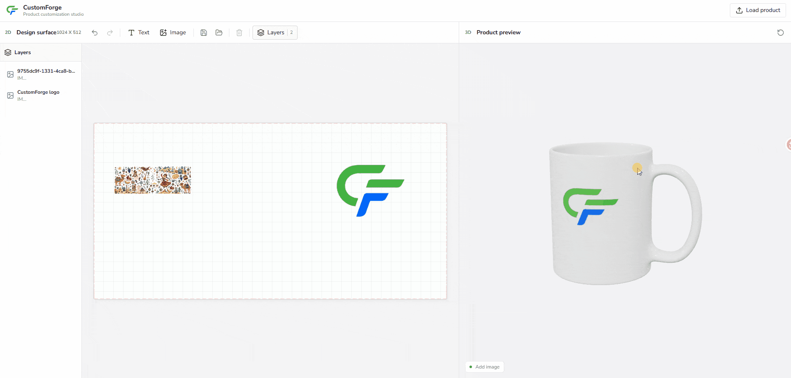
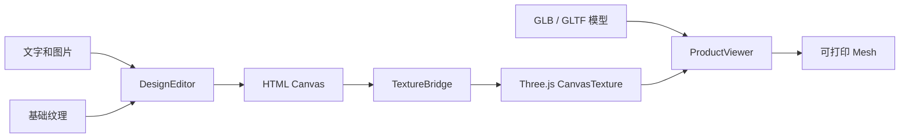

<div align="center">


<h1>CustomForge</h1>

<p>用 TypeScript 在二维画布上编辑文字和图片，实时查看它们在三维商品上的效果</p>

<p><strong>官网：</strong><a href="https://customforge.org">https://customforge.org</a></p>

<p>
  <a href="./README.md">English</a>
  <span> · </span>
  <strong>简体中文</strong>
</p>

<p>
  <a href="https://www.npmjs.com/package/customforge"></a>
  <a href="./LICENSE"></a>
</p>

</div>

## 操作演示



## 快速开始

在你的前端项目中安装：

```bash
npm install customforge
```

使用 pnpm 时运行 `pnpm add customforge`。Fabric.js 和 Three.js 会随包安装

添加一个有明确高度的容器：

```html
<div id="customforge-workbench" style="height: 640px"></div>
```

在应用的客户端入口中，等容器挂载后创建工作台：

```ts
import { createWorkbench } from 'customforge/workbench'
import 'customforge/style.css'

const workbench = await createWorkbench({
  container: '#customforge-workbench',
})
```

这个示例会加载随包提供的杯子模型和默认编辑界面。在左侧添加文字或上传图片，杯子上的设计会随编辑实时更新，不需要先准备模型文件

不再使用编辑器时调用 `workbench.destroy()`。在 React、Vue 等组件框架中，应在客户端挂载后初始化，并在组件卸载时销毁实例

需要使用自己的按钮和面板时，从 `customforge` 导入 `createCustomizer()`，参见[自定义界面](#自定义界面)

## 文档

- [快速开始](https://customforge.org/zh/guide/quick-start.html)
- [配置 Workbench](https://customforge.org/zh/guide/workbench.html)
- [使用核心 API 自定义界面](https://customforge.org/zh/guide/core-library.html)
- [准备商品模型](https://customforge.org/zh/guide/product-assets.html)

## 功能

CustomForge 使用 Fabric.js 编辑二维画布，使用 Three.js 预览商品。可以在原生 TypeScript 项目或前端框架中接入

- 编辑文字内容、字体、字号、颜色、对齐方式和间距
- 上传、移动、缩放和旋转图片，或将图片铺满可打印区域作为背景
- 上传 GLB 或加载远程 GLB/GLTF，指定可打印 Mesh，并旋转、缩放商品预览
- 按模型 UV 边界显示编辑辅助线，导出 PNG 时不包含辅助线和选择框
- 管理图层、撤销和重做，通过 Design JSON 保存和恢复可编辑设计
- 调整工作台的品牌、文案、主题、图标和预设素材，扩展业务按钮，或通过核心 API 自建界面

## 浏览器与安装说明

浏览器基线：Chrome 和 Edge 111+、Firefox 113+、Safari 16.4+。CustomForge 需要 ES2022 模块、Canvas 2D、WebGL、`ResizeObserver`、原生 `dialog`、容器查询和 `color-mix()` 支持

pnpm 可能提示可选的原生 `canvas` 构建脚本已被忽略。CustomForge 运行在浏览器中，不使用 Node 原生 canvas，因此接入这个包不需要执行 `pnpm approve-builds`

项目可以在 `package.json` 中明确记录这一选择：

```json
{
  "pnpm": {
    "ignoredBuiltDependencies": ["canvas"]
  }
}
```

## 加载你的产品

在演示页面中选择 **Load product**，然后上传一个资源完整的本地 `.glb` 文件，或填写远程 GLB / GLTF 地址。本地 `.gltf` 文件可能依赖独立的二进制文件和纹理，因此不支持直接上传

以下设置位于默认收起的 **Advanced options** 中：

| 设置 | 用途 |
| --- | --- |
| Base artwork URL | 放在可编辑对象下方，并包含在合成纹理中的可选图片 |
| Printable mesh name | 接收实时画布纹理的 Mesh 名称，默认为 `PrintArea` |
| Flip texture vertically | 仅在设计内容显示为上下颠倒时启用 |

UV 坐标应当保存在三维模型中

可选的纹理图片只是二维编辑器的基础图层，不能替代模型中的 UV 数据；未提供时，设计画布保持透明，三维端透出模型原有底材

每次加载产品后，编辑器会读取目标 Mesh 的 UV 坐标，并在设计画布上方显示轻微的可打印区域底纹及其外边界。内部三角剖分保持隐藏，该辅助层不会写入实时纹理、Design JSON 或导出的 PNG

高面数可打印 Mesh 的辅助填充不会再逐三角形同步闭合路径，生产渲染也不会读取 Canvas 像素。模型下载、Geometry 提取、GPU 工作量和内存占用仍会随模型复杂度增长，因此生产模型仍应只保留商品外观和可打印表面需要的细节

> [!IMPORTANT]
> 远程模型、纹理、贴图和字体必须提供允许当前页面来源访问的 CORS 响应头
>
> 被浏览器阻止或污染 Canvas 的资源可能无法加载，也会导致 PNG 导出失败

## UV 映射与画布元数据

以下映射能力需要 `0.2.1` 或更高版本；已发布的 `0.1.2` 不支持这些接口。本地验证时，请使用当前源码重新打包的制品，再升级消费方

默认仍使用 UV0 和 `[0,1] × [0,1]` 原始坐标域，不会自动填满模型的 UV 留白。负 UV 是有效的模型数据，但原始模式会把域外采样夹到纹理边缘。需要将整个打印布局对应到完整设计图时，显式配置：

```ts
const workbench = await createWorkbench({
  container: '#customforge-workbench',
  editorWidth: 1200,
  editorHeight: 600,
  product: {
    modelUrl: 'https://example.com/product.glb',
    surfaceMesh: 'PrintArea',
    uvChannel: 0,
    uvMapping: { mode: 'fit-bounds' },
    textureFlipY: false,
    modelRevision: 'sha256:content-hash-from-your-asset-service',
  },
  onDiagnostic: (diagnostic) => console.log(diagnostic.code, diagnostic.message),
  formatDiagnostic: (diagnostic) => diagnostic.message,
})

const resolved = workbench.customizer.getPrintSurfaceInfo()
const design = workbench.customizer.saveDesign()
```

`1200 × 600` 仅演示配置方式，不是从模型推断出的物理印刷尺寸。核心 `createCustomizer()` 和 `createWorkbench()` 均支持映射、尺寸、初始文档和诊断回调；`formatDiagnostic` 仅属于 Workbench

| 产品选项 | 行为 |
| --- | --- |
| `uvMapping: { mode: 'original' }` | 默认行为，保留标准域与原有留白 |
| `uvMapping: { mode: 'fit-bounds' }` | 对第一材质槽实际三角形执行统一仿射转换，保留各 UV 岛的相对关系 |
| `uvMapping: { mode: 'domain', domain: { minU, minV, maxU, maxV } }` | 使用有限且非退化的参考矩形，可保留作者约定的边距 |
| `uvChannel: 0 \| 1 \| 2 \| 3` | 二维辅助线、边界和三维采样使用同一通道，缺失时失败，不回退到其他通道 |
| `modelRevision` | 由宿主提供的不可变内容标识，不能仅凭 URL 判断模型内容一致 |

设计纹理使用独立矩阵和 alpha 合成。模型原始 UV、底材贴图及其变换、PBR 参数保持独立；空白设计会露出原有底材，不会清除模型本身的颜色

模型需要声明配置时，在选定 glTF **节点**的 `extras` 中放入以下结构，并主动启用 `readModelMetadata: true`：

```json
{
  "customforge": {
    "version": 1,
    "canvas": { "width": 1200, "height": 600 },
    "printSurface": {
      "uvChannel": 0,
      "textureFlipY": false,
      "uvMapping": { "mode": "fit-bounds" }
    }
  }
}
```

新建设计按成对显式宽高、正式节点元数据、兼容的 `customforgeGuide.canvas` 或 `canvasWidth/canvasHeight`、`1024 × 512` 默认值依次解析。未启用时不读取元数据。元数据模式必须同时传入显式宽高，不会将显式宽度与元数据高度拼接；关闭元数据时，旧版只传单边的方式仍用另一边默认值

宽高必须是正整数，单边不超过 8192，总面积不超过 16,777,216 像素，同时受当前设备最大纹理尺寸限制。以上均为逻辑像素；调整界面只改变显示比例。非法或超限元数据在创建 Fabric 画布前被拒绝

`getPrintSurfaceInfo()` 返回实际尺寸、原始边界、三角形数量、数值映射、逐项来源和诊断的独立快照。初始化诊断可从 `onDiagnostic` 和快照取得；后续加载可订阅 `diagnostic`。Workbench 警告文案可通过 `formatDiagnostic` 翻译，抛出的 `PrintSurfaceError` 提供稳定 `code`，供 `formatError` 或宿主处理

域外采样会报告 `UV_OUTSIDE_DESIGN_DOMAIN`。缺少通道、非法 UV、新模式退化域、尺寸不兼容和映射冲突会明确失败。原始模式保留可见区域退化时的历史整画布边界回退，并提供诊断；启用读取却没有尺寸时报告 `CANVAS_METADATA_MISSING`，无法验证模型内容身份时报告 `MODEL_REVISION_UNVERIFIED`

### 恢复与升级

| 文档 | 读取行为 | 默认写入行为 |
| --- | --- | --- |
| Schema 1 | 使用保存尺寸、旧版 UV0/原始域和外层 `textureFlipY` 配置 | 未启用新映射能力时继续保存为 Schema 1 |
| Schema 2 | 使用保存尺寸、数值域、节点、通道、方向及可选内容版本 | 新映射、非默认通道或显式持久化映射配置使用 Schema 2 |

在创建画布前恢复设计：

```ts
const restored = await createWorkbench({
  container: '#customforge-workbench',
  product: {
    modelUrl: 'https://example.com/product.glb',
    modelRevision: 'sha256:content-hash-from-your-asset-service',
  },
  initialDesign: savedDesignDocument,
})
```

Schema 1 还需传入外层保存的 `textureFlipY`，旧文档本身未保存方向。保存的配置优先于当前模型元数据，显式传入的冲突配置会被拒绝。Schema 2 保存解析后的**数值**，回放不会按新模型重算 `fit-bounds`。已知内容版本不同会失败；缺少内容版本时报告未验证

运行时恢复会保留文档自身的可选 `modelRevision`，包括字段缺省的情况。从之前文档继承的版本不代表实际模型的身份证明。恢复、撤销和重做后，`modelRevisionVerified` 及对应诊断会随当前文档更新；只有宿主为实际模型提供的版本与文档明确一致时才标记为已验证

运行时 `loadDesign()` 要求尺寸与映射相容，不迁移坐标或切换模型。`loadProduct()` 保留对象坐标和现有画布，成功后更新映射并重设历史；新产品声明不同尺寸时拒绝，未声明尺寸时沿用当前画布，来源标为 `sources.canvas: 'instance'`。准备失败保留原产品，后发请求或销毁会以 `AbortError` 取消旧提交；意外提交失败会销毁不可用实例并要求重建

**先升级所有文档读取方，再启用 Schema 2 写入**，包括管理端回放。已发布 `0.1.2` 的读取器无法识别 Schema 2。模型 URL 和资源归属仍由业务外层管理，同时核对服务端对设计版本和大小的校验

本能力不进行 UV 重展开、独立 UDIM 编辑、去重叠、拉伸补偿或物理尺寸推断。背景仍拉伸到打印包围矩形；矩形不是精确轮廓蒙版，本轮未实现 `cover`/`contain` 或按轮廓裁剪导出

## 自定义界面

`createCustomizer()` 提供编辑器和查看器，将它们挂载到两个不同的 DOM 容器后，通过返回的 `ProductCustomizerApi` 连接你自己的控件：

CustomForge 仅支持浏览器环境，应在 DOM 挂载容器可用后创建实例

编辑器和查看器必须使用两个不同的容器；页面卸载、组件卸载或不再使用实例时必须调用 `destroy()` 释放 Fabric、WebGL、观察器和事件资源

替换产品或候选模型加载失败时会释放模型持有的解码位图。销毁实例也会使其 WebGL 上下文失效，再次使用时须创建新实例。

```html
<div id="texture-editor"></div>
<div id="product-viewer"></div>
```

```ts
import { createCustomizer } from 'customforge'
import 'customforge/style.css'

const customizer = await createCustomizer({
  editor: '#texture-editor',
  viewer: '#product-viewer',
  editorWidth: 1024,
  editorHeight: 512,
  product: {
    modelUrl: 'https://example.com/product.glb',
    textureUrl: 'https://example.com/base-texture.png',
    surfaceMesh: 'PrintArea',
    textureFlipY: false,
  },
  appearance: {
    editor: {
      controlSize: 7,
      objectBorder: '#0057b8',
      uvBoundary: '#d92d20',
    },
    viewer: { backgroundColor: '#f4f4f5' },
  },
})

customizer.addText({
  text: 'Hello world',
  x: 120,
  y: 180,
  fontSize: 64,
  fontWeight: 'bold',
  textAlign: 'center',
  color: '#172126',
})

await customizer.addImage({
  src: 'https://example.com/logo.png',
  x: 720,
  y: 240,
  width: 220,
})

window.addEventListener('beforeunload', () => customizer.destroy(), {
  once: true,
})
```

公开包与本地 `.tgz` 使用相同的根入口和样式入口；需要可重复安装时应固定具体版本

## 配置 Workbench

通过 `createWorkbench()` 的配置传入商品、品牌和界面文案，或调整工作台布局

挂载元素必须设置明确高度，设计画布、图层面板和三维区域才能正确计算可用空间

```html
<div id="customforge-workbench" style="height: 720px"></div>
```

```ts
import { createWorkbench } from 'customforge/workbench'
import 'customforge/style.css'

const workbench = await createWorkbench({
  container: '#customforge-workbench',
  className: 'store-customizer',
  product: {
    modelUrl: 'https://example.com/product.glb',
    surfaceMesh: 'PrintArea',
  },
  features: {
    presetBackgrounds: true,
    presetElements: true,
  },
  layout: {
    header: true,
    layers: true,
  },
  branding: {
    logoUrl: '/brand/logo.png',
    title: '定制工作室',
    subtitle: '产品个性化设计',
  },
  labels: {
    addText: '文字设计',
    addImage: '图片素材',
    productDialogTitle: '选择商品模型',
    loadingProduct: '正在加载商品……',
  },
  fontFamilies: [
    { value: 'Arial', label: '无衬线字体' },
    { value: 'Georgia', label: '衬线字体' },
  ],
  formatError: () => '资源加载失败，请检查文件或网络连接',
  theme: {
    accent: '#0057b8',
    accentHover: '#003f87',
    accentContrast: '#ffffff',
  },
  assets: {
    backgrounds: [
      { id: 'floral', name: '花卉背景', url: '/presets/floral.png' },
    ],
    elements: [
      { id: 'flower', name: '小花', url: '/presets/flower.png' },
    ],
  },
})
```

默认使用包内的 CustomForge Logo，可以通过 `branding` 替换或隐藏

`labels` 覆盖 Workbench 中所有固定标签、Dialog 文案、占位符、校验提示、状态、颜色名称、下载文件名和无障碍名称。由配置数据生成的可见名称分别通过 `fontFamilies`、`textPresets`、`assets` 和 `branding` 传入，模型、图片、UV 与 Design JSON 异常则通过 `formatError` 转换为面向用户的提示

CustomForge 提供默认英文文案，但不接管应用的当前语言状态。宿主项目应从自身 i18n 系统生成配置，并使用当前语言包创建 Workbench，从而避免与 Vue I18n、React Intl 或其他国际化方案耦合

编写完整语言包时可以使用导出的 `WorkbenchLabels` 类型进行字段完整性检查；`WorkbenchOptions.labels` 仍保持为可选字段集合，少量改词时无需重复全部默认值

`theme` 映射到限定作用域的 CSS 变量，`icons` 可以关闭内置图标或用图片地址替换指定语义图标

`appearance` 用于配置普通 Workbench CSS 无法可靠控制的 Fabric 选择控件、UV 辅助颜色和 WebGL 清屏颜色

默认界面字体栈优先使用圆润的 `Nunito Sans`，不可用时回退到系统无衬线字体

CustomForge 会随制品提供该字体资源，不会在运行时请求第三方字体服务

文字和图片命令现在会打开专用 Dialog，不会在点击工具栏按钮后立即修改画布

- 文字 Dialog 提供文本输入、颜色选择和可替换的排版预设
- 选中一个或多个文字对象时，现有单行工具栏会在不推动画布的情况下显示上下文格式控件，用于调整字体、字号、粗体、斜体、下划线、对齐、文字色、高亮色、行高和字距
- 上下文格式栏支持多选混合状态，并提供明确的画布内文字编辑入口
- 图片 Dialog 提供本地上传、预设背景和装饰元素
- 设计背景会替换已有设计背景、铺满当前商品的 UV 可打印边界、默认锁定在最底层并保存到 Design JSON
- 选中普通图片后可以将其转换为设计背景，自动适配当前 UV 可打印边界并移动到最底层

功能和布局开关也可以在初始化后动态调整

```ts
workbench.setFeature('addText', true)
workbench.setLayout('header', true)
workbench.setTheme({ accent: '#0057b8' })
```

### 向 Workbench 扩展业务按钮

业务按钮应通过 `extensions` 注册，不要查询或改写 Workbench 内部 DOM。每个操作都会收到公开的 Workbench 与无界面 customizer 接口、最新状态快照、当前选区，并在需要时收到对应图层：

```ts
const workbench = await createWorkbench({
  container: '#customforge-workbench',
  className: 'store-customizer',
  extensions: [
    {
      id: 'store.export-png',
      placement: 'globalActions',
      label: t('actions.exportPng'),
      variant: 'primary',
      className: 'store-export-command',
      onClick: async ({ customizer, workbench, signal }) => {
        const blob = await customizer.getTextureBlob()
        if (!signal.aborted) {
          workbench.setStatus(`${blob.size} bytes`)
        }
      },
    },
    {
      id: 'store.straighten',
      placement: 'selectionToolbar',
      label: t('actions.straighten'),
      visible: ({ selection }) => selection.length === 1,
      disabled: ({ selection }) => selection.some(({ locked }) => locked),
      onClick: ({ customizer, selection }) => {
        selection.forEach(({ id }) => {
          customizer.updateObjectTransform(id, { rotation: 0 })
        })
      },
    },
  ],
})
```

| 挂载位置 | 适用场景 | 额外上下文 |
| --- | --- | --- |
| `globalActions` | 商品、导出或流程级命令 | 标准状态与选区 |
| `editorToolbar` | 不要求选中对象的设计命令 | 标准状态与选区 |
| `selectionToolbar` | 作用于当前选区的命令 | 没有选区时自动隐藏 |
| `layerActions` | 在每个图层重复出现的紧凑命令 | `layer` 为当前行对象 |

`visible` 和 `disabled` 可以是布尔值或状态判断函数。核心状态、选区、历史和视角事件发生后会自动重新计算；如果条件还依赖宿主应用状态，应调用 `workbench.refreshExtensions()`。返回 Promise 的操作会自动进入 loading 并禁用防重复点击；被拒绝的 Promise 会通过 `formatError` 转换后显示到现有状态区域。

可以通过 `iconUrl`、`showLabel`、`variant`、`order` 和 `className` 控制表现。扩展按钮文案属于业务数据，应传入当前语言对应的字符串。更深层的 CSS 定制应同时使用 Workbench 的 `className` 和扩展自身的 `className` 限定作用域：

```css
.store-customizer .store-export-command {
  text-transform: uppercase;
}
```

初始化后也可以管理扩展。注册方法返回的清理函数只会移除由该次注册创建的项目：

```ts
const unregister = workbench.registerExtension(action)
const actions = workbench.getExtensions()
workbench.removeExtension('store.export-png')
unregister()
```

`workbench.getFeatures()`、`workbench.getLayout()`、`workbench.getTheme()` 和 `workbench.getExtensions()` 返回互不影响的配置快照。`className` 只添加到当前 Workbench 根元素，宿主 CSS 可以精确作用于某个实例，而不需要依赖全局选择器。需要完全自定义界面时，应使用 `createCustomizer()`，不要查询或改写 Workbench 内部 DOM。

| 功能开关 | 控制内容 |
| --- | --- |
| `addText`、`addImage`、`deleteSelection` | 对象 Dialog 和删除操作 |
| `textFormatting` | 上下文文字格式栏 |
| `undoRedo` | 撤销、重做按钮和 Workbench 键盘快捷键 |
| `saveDesign`、`loadDesign` | Design JSON 操作 |
| `loadRemoteProduct`、`resetView` | 产品加载和预览操作 |
| `reorderObjects`、`toggleObjectVisibility`、`lockObjects`、`renameObjects` | 图层管理 |
| `presetBackgrounds`、`presetElements` | 图片 Dialog 中的预设素材页签 |

| 布局开关 | 控制区域 |
| --- | --- |
| `header` | 品牌和全局产品操作 |
| `editorHeader`、`viewerHeader` | 工作区面板标题栏 |
| `toolbar` | 设计工具栏 |
| `layers` | 对象图层面板 |
| `status` | 运行状态和对象数量 |

所有功能和布局开关默认均为 `true`

功能开关只控制 Workbench 自带控件，不会移除 `workbench.customizer` 上的底层方法。Workbench 顶栏不再提供 PNG 导出入口，仍可通过 `workbench.customizer.exportTexture()` 使用底层导出能力

主题配置用于统一的产品级视觉调整，不提供难以维护的逐按钮颜色配置

```ts
const workbench = await createWorkbench({
  container: '#customforge-workbench',
  icons: {
    enabled: true,
    sources: {
      addText: '/icons/typography.svg',
      loadProduct: '/icons/upload.svg',
    },
  },
  textPresets: [
    {
      id: 'brand-display',
      name: '品牌展示',
      fontFamily: 'Arial',
      fontSize: 72,
      width: 460,
      color: '#17191c',
    },
  ],
})
```

## Design JSON

`saveDesign()` 返回由 Library 自身定义、可安全写入 JSON 的文档，不暴露 Fabric.js 序列化格式。`loadDesign()` 校验未知输入，并异步恢复可编辑对象栈：

```ts
const design = customizer.saveDesign()
localStorage.setItem('customforge-design', JSON.stringify(design))

const savedDesign = localStorage.getItem('customforge-design')
if (savedDesign) {
  await customizer.loadDesign(JSON.parse(savedDesign))
}
```

文档读取器支持 Schema `1` 和 `2`。两者均保存逻辑画布尺寸，并按从后到前的渲染顺序保存文字和图片对象，包括稳定对象 ID、名称、显隐、锁定状态、图片用途、基于中心点的变换和丰富的文字排版属性。Schema 2 还保存上文所述的解析映射。缺少可选排版字段的旧版 version 1 文档仍按原有的粗体、居中默认值加载

Design JSON 不包含模型文件、模型 URL 和基础纹理，Schema 2 会在映射中保存打印节点名称。文档只能加载到逻辑宽高相同且映射相容的编辑器中

带有 `role: 'background'` 的图片是设计对象，不是产品基础纹理，只允许存在一个并且必须位于对象数组首位，旧版 v1 文档缺少 `role` 时继续按普通图片元素加载

加载具有事务性：只有文档校验通过且全部引用图片成功加载后，当前设计才会被替换。Blob URL 图片会在添加时转换为 Data URL；远程图片仍保留 URL，恢复时必须继续满足浏览器 CORS 要求

Design JSON version 1 在整个 `0.1.x` 版本线内保持可读取兼容。后续可以增加可选字段，但不会让现有 version 1 文档失效

## 撤销与重做

无界面核心和 Workbench 都支持历史记录，默认保留 50 个撤销步骤

可以在 `createCustomizer` 或 `createWorkbench` 配置中通过 `historyLimit` 调整保留的撤销深度

```ts
if (customizer.canUndo()) {
  await customizer.undo()
}

await customizer.redo()
customizer.clearHistory()

const stop = customizer.on('historychange', ({ canUndo, canRedo }) => {
  console.log({ canUndo, canRedo })
})
```

历史记录覆盖对象添加、删除、画布变换、文字内容与格式编辑、图片转背景、图层排序、名称、显隐、锁定和 Design JSON 加载

Workbench 在焦点不位于表单控件时支持 `Ctrl` 或 `Cmd` + `Z`、`Ctrl` 或 `Cmd` + `Shift` + `Z` 和 `Ctrl` + `Y`

成功更换产品后会保留当前设计对象，但以当前设计重新开始历史记录

## 实例 API

| 方法 | 说明 |
| --- | --- |
| `addText(options)` | 添加并选中文字并自动约束在画布内；`fontSize` 默认为 `22` |
| `addImage(options)` | 加载普通图片元素或替换设计背景 |
| `getState()` | 一次返回商品、画布、可打印边界、对象、选区、历史和三维视角快照 |
| `getProduct()` | 返回补全默认值后的当前商品配置 |
| `getCanvasSize()` | 返回逻辑纹理尺寸 |
| `getPrintableBounds()` | 返回逻辑画布坐标中的 UV 可打印边界 |
| `getPrintSurfaceInfo()` | 返回解析映射、来源、实际尺寸、内容版本验证和诊断 |
| `getObjects()` | 按从后到前的图层顺序返回当前对象 |
| `getSelectedObjectIds()` | 返回当前选区中的稳定对象 ID |
| `selectObject(id)` | 根据稳定 ID 选中可见对象 |
| `selectObjects(ids)` | 根据稳定 ID 多选可见对象 |
| `clearSelection()` | 清除当前画布选区且不修改设计内容 |
| `removeObject(id)` | 根据稳定 ID 删除对象 |
| `moveObject(id, index)` | 将对象移动到从 0 开始的图层索引 |
| `setImageAsBackground(id)` | 使用现有图片替换设计背景并自动适配当前 UV 可打印边界 |
| `renameObject(id, name)` | 修改图层工具中显示的对象名称 |
| `setObjectVisibility(id, visible)` | 设置对象是否参与渲染 |
| `setObjectLocked(id, locked)` | 锁定或解锁画布变换 |
| `updateObjectTransform(id, options)` | 根据稳定 ID 修改中心位置、缩放、旋转和翻转 |
| `updateText(id, options)` | 按稳定 ID 修改文字内容和排版样式 |
| `editText(id)` | 让未锁定文字进入画布内编辑状态 |
| `deleteSelected()` | 删除当前对象或选区 |
| `saveDesign()` | 返回当前版本化 Design JSON 文档 |
| `loadDesign(value)` | 校验并以事务方式恢复 Design JSON |
| `canUndo()`、`canRedo()` | 查询当前可用的历史方向 |
| `undo()`、`redo()` | 恢复前一个或后一个设计快照 |
| `clearHistory()` | 将当前设计设为新的历史起点 |
| `loadProduct(product)` | 更换模型、基础纹理和目标 Mesh |
| `getTextureDataUrl()` | 以 PNG Data URL 返回合成纹理 |
| `getTextureBlob()` | 以 PNG Blob 返回合成纹理 |
| `exportTexture(filename?)` | 将合成纹理下载为 PNG |
| `getViewState()`、`setViewState(state)` | 读取或恢复三维相机位置和观察目标点 |
| `resetView()` | 恢复默认三维相机位置 |
| `on(event, listener)` | 订阅实例事件，并返回取消订阅函数 |
| `destroy()` | 释放 DOM 事件、Fabric 状态和 WebGL 资源 |

当前事件包括 `ready`、`change`、`selectionchange`、`historychange`、`viewchange`、`diagnostic`、`status` 和 `error`

无界面能力契约导出为 `ProductCustomizerApi`，默认界面能力契约导出为 `CustomForgeWorkbenchApi`。具体类仍然保留，但消费方可以只依赖接口，避免业务代码与实现细节耦合。

`ProductCustomizer` 不公开 Fabric.js 编辑器和 Three.js 查看器实例，使用方只通过门面 API 操作定制器

不支持从 `core`、`editor`、`viewer`、`bridge` 或其他未声明的包子路径导入模块

## 架构



```text
ProductCustomizer
|-- DesignEditor      Fabric.js 渲染和对象交互
|-- ProductViewer     Three.js 场景、模型、材质和相机
`-- TextureBridge     Canvas 到材质的同步
```

`ProductCustomizer` 负责协调各模块，并将 Fabric.js 和 Three.js 的实现细节隐藏在小型实例 API 后面

可选 Workbench 和演示界面使用原生 TypeScript，核心不依赖 Vue、React 或其他 UI 框架

## 模型约定

当前模型约定要求：

- GLB 或 GLTF 模型包含有效的 UV 坐标
- 模型未经压缩，能够由标准 Three.js `GLTFLoader` 直接加载
- 模型具有一个用于定制表面的命名 Mesh，例如 `PrintArea`
- 目标纹理位于该 Mesh 的第一个材质槽中
- 浏览器可以在 CORS 策略下访问远程资源地址

随包提供的默认模型将完整杯体保存为 `MugBody`，并将带 UV 的可打印贴花层保存为 `PrintArea`。CustomForge 会保留杯体材质，只把实时设计纹理应用到 `PrintArea`

## 仓库开发

环境要求：Node.js 22+ 和 pnpm 11+。在仓库根目录运行：

```bash
pnpm install
pnpm dev
```

打开 Vite 输出的地址即可运行本地演示

### 本地验证 npm 包

构建并打包：

```bash
pnpm pack:local
```

命令会构建 JavaScript、TypeScript 声明和样式，检查 npm 文件清单，并生成 `customforge-0.2.1.tgz`。在其他项目中安装时，将以下路径替换为该文件的绝对路径：

```bash
pnpm add /absolute/path/to/customforge-0.2.1.tgz
```

仓库中的 [npm 消费示例](./examples/npm-consumer)和 [API 契约消费示例](./examples/api-contract-consumer)独立于源码 workspace 安装该 tarball，具体启动和验证方法见各自的 README

## 项目结构

```text
src/
|-- bridge/           Canvas 与 Three.js 纹理同步
|-- core/             公共类型、配置和 DOM 工具
|-- customizer/       公共实例编排
|-- demo/             可运行的工作台界面
|-- editor/           Fabric.js 设计画布和快照历史
|-- style.css         Library 公开样式入口
|-- styles/           核心和 Workbench 样式
|-- viewer/           Three.js 产品预览
|-- workbench/        可配置界面、Dialog、图标和预设素材
`-- index.ts          与框架无关的源码入口

examples/
|-- api-contract-consumer/  公共 API、自定义界面与浏览器 smoke 消费示例
`-- npm-consumer/           本地 .tgz 独立消费示例

scripts/
|-- run-browser-smoke.mjs  无头浏览器契约门禁
|-- verify-consumers.mjs   独立 tarball 消费门禁
|-- verify-package.mjs     npm 文件和制品边界检查
`-- verify-release.mjs     版本、变更日志、标签和示例检查
```

## 开发命令

```bash
pnpm check       # TypeScript 项目检查
pnpm test        # 单元测试
pnpm build       # 类型检查和生产构建
pnpm build:lib   # 构建核心与 Workbench ESM、类型声明和样式
pnpm verify:release # 检查稳定版本、变更日志、标签和消费路径
pnpm verify:package # 检查 dist 和 npm 文件清单
pnpm verify:consumers # 在两个独立消费项目中安装并构建本地 .tgz
pnpm test:browser # 在无头 Chrome 中运行打包后的 API 消费示例
pnpm pack:local  # 通过 prepack 构建、检查并生成本地 .tgz
pnpm release:check # 执行完整的稳定版发布门禁
pnpm preview     # 预览生产构建
```

npm Trusted Publishing 配置、标签规则、发布步骤和失败处理参见[发布指南](https://github.com/songshanliu/CustomForge/blob/main/RELEASING.md)

## 当前范围

`0.1.0` 是首个非预发布制品。项目仍处于 `0.x` 版本线，公共 API 的破坏性调整只会进入后续次版本，并记录在变更日志中

当前版本聚焦于一张逻辑设计画布映射到一个命名 Mesh 的第一个材质槽。Design JSON version 1 文档在 `0.1.x` 内保持可读取兼容

多定制面、高级对齐工具和框架适配器仍未实现

## 技术栈

- [Fabric.js](https://fabricjs.com/)：二维编辑画布
- [Three.js](https://threejs.org/)：模型加载和实时三维渲染
- [Lucide](https://lucide.dev/)：打包到 Workbench 中的界面图标
- [Vite](https://vite.dev/)：开发环境和应用构建
- [TypeScript](https://www.typescriptlang.org/)：启用严格类型检查

## 开源协议

CustomForge 依据 Apache License 2.0 开源

完整协议内容请参阅 [LICENSE](./LICENSE)

第三方依赖和资产仍遵循各自的许可条款

随包提供的 Nunito Sans 字体遵循 SIL Open Font License 1.1，完整条款见 [NunitoSans-OFL.txt](./LICENSES/NunitoSans-OFL.txt)

随包提供的 Plain Mug 模型由 LightSwitch 创作并采用 CC BY 4.0，署名和来源信息见 [plain-mug-CC-BY-4.0.txt](./LICENSES/plain-mug-CC-BY-4.0.txt)
